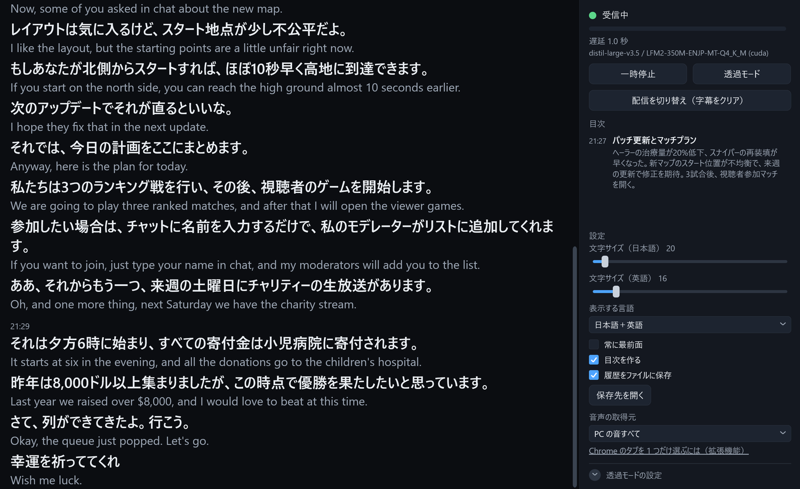

# ライブ字幕（英語 → 日本語）

英語の配信（Twitch / YouTube など）の音声を、ローカルだけでリアルタイムに日本語字幕にします。
音声もテキストも外部には送信しません。

> **English:** LiveSubs shows live Japanese subtitles for English speech playing on your PC, such as a Twitch or
> YouTube live stream. Everything runs locally: voice activity detection, speech recognition (faster-whisper,
> distil-large-v3.5) and translation (PLaMo 3 Translate 2B) run on your own NVIDIA GPU inside WSL2, and no audio or text
> leaves the machine. A small native Windows app shows the subtitles in a window or in a transparent overlay on top of
> the stream, about one second after the end of each sentence. It needs Windows 11, WSL2 (Ubuntu), an NVIDIA GPU with
> about 3 GB of free VRAM, [uv](https://docs.astral.sh/uv/) and, to build the app, [Rust](https://rustup.rs). The app's
> interface and the rest of this README are in Japanese.



（自作の台本を合成音声に読ませ、その音声を実際に認識・翻訳させたときの画面です。訳文には手を加えていません）

## 必要なもの

- Windows 11（Windows 10 では試していません）
- WSL2 の Ubuntu（管理者の PowerShell で `wsl --install` を実行すると入る標準の構成）
- NVIDIA の GPU と、Windows 側のドライバー。VRAM は約3GB 使います（目次を作る数秒間だけ、さらに約2GB）。
  WSL の中に CUDA を入れる必要はありません（必要なライブラリは自動で入ります）
- WSL の中に [uv](https://docs.astral.sh/uv/)。Python 本体とライブラリは uv が用意します
- WSL の中に [Rust](https://rustup.rs)。Windows アプリのビルドに使います（Visual Studio などは要りません）
- 空き容量 約13.5GB（Rust 約1.5GB、ライブラリ 約4.4GB、モデル 約3.2GB、目次用モデル 約1.5GB、認識モデルの変換した写し 約0.8GB）
- タブを1つだけ字幕にしたい場合は Chrome

## 入れ方

WSL（Ubuntu）の端末で:

```bash
curl -LsSf https://astral.sh/uv/install.sh | sh    # uv をまだ入れていない場合
git clone https://github.com/yu-geni/livesubs.git
cd livesubs
./run.sh
```

初回はライブラリとモデルのダウンロードで数分かかります。`ready: open http://localhost:8765` と出たら準備完了です
（この時点で、下の「ブラウザ版」が使えます）。Ctrl+C で止めてから、Windows アプリを作ります:

```bash
curl --proto '=https' --tlsv1.2 -sSf https://sh.rustup.rs | sh -s -- -y    # Rust をまだ入れていない場合
. "$HOME/.cargo/env"
rustup target add x86_64-pc-windows-gnu
bash windows/build.sh
```

アプリは Rust で書かれていて、WSL の中で Windows 用の exe にビルドします。リンクに使う zig は uv が自動で用意するので、
Visual Studio などを入れる必要はありません。初回のビルドは1〜2分かかります。
`%LOCALAPPDATA%\LiveSubs\` に exe と拡張機能（`extension` フォルダー）が置かれ、デスクトップに「ライブ字幕」のショートカットができます。

- リポジトリは WSL の中（`/home/...`）の、空白を含まない場所に置いてください。場所を変えたときは、もう一度
  `bash windows/build.sh` を実行します（エンジンの場所を `LiveSubs.ini` に書き込むため）。
- うまく動かないときは、アプリ右サイドのいちばん上に出る状態表示と、 `%APPDATA%\LiveSubs\log.txt` を見てください。
  エンジンが出したメッセージもここに残ります。

**スマート アプリ コントロール**が有効だと、署名のない自作 exe は起動を止められることがあります
（ビルドごとに通ったり止められたりします）。確実に使うには Windows セキュリティ →
アプリとブラウザー コントロール → スマート アプリ コントロールの設定 でオフにしてください。

## Windows アプリの使い方

デスクトップの **「ライブ字幕」** をダブルクリックするだけです。裏で翻訳エンジン（WSL）が自動で起動し、
アプリを閉じると約20秒後にエンジンも止まって GPU メモリを解放します。
起動してから字幕が出せるようになるまでは約5秒です（初めて起動したときだけ約8秒。その間に、認識モデルを読み込みやすい形に
変換した写し 約0.8GB を `~/.cache/livesubs/asr/` に作り、2回目から使います）。
PC で再生中の音をそのまま拾うので、ブラウザの共有操作は要りません（通知音なども対象になります）。

- **通常表示**: 左に翻訳が縦いっぱいに流れ、上にスクロールすればさかのぼれます（「↓ 最新へ」で戻る）。
  右サイドに状態・一時停止・目次・設定がまとまっています。目次の行を押すとその場面へ移動します。
- **透過モード**: 右サイドの「透過モード」で、配信に重ねる透明な字幕ウィンドウに切り替え。
  ウィンドウの高さいっぱいまで字幕が並び、上下左右の端や角をドラッグすると大きさを変えられます
  （中央をドラッグすると移動）。右クリックかタスクトレイのアイコンから「通常表示に戻す」。
- **表示する言語**: 「日本語のみ／日本語＋英語／英語のみ」を右サイドの設定で選べます。
- **配信を切り替え**: 別の配信に移るときに押すと、字幕と目次を消して始め直します（履歴ファイルも新しく分かれます）。
- **音声の取得元**: 右サイドの設定で「PC の音すべて」か、起動中のアプリ（Chrome、メディア プレーヤー、VLC など）を選べます。
  音を出しているアプリは、ウィンドウがなくても（トレイに隠れたプレーヤーやストアアプリでも）一覧に出て、再生中のものには「（再生中）」と付いて上に並びます。
  選んだアプリが再生中なのに、そのアプリ単体では音が取れない場合は（Windows の都合でそういうアプリがあります）、6秒後に自動で「PC の音すべて」に切り替えて字幕を続けます。
  アプリを選ぶと、そのアプリが鳴らしている音だけを字幕にします（通知音やボイスチャットは入りません）。
  Chrome のタブを1つだけ選びたいときは、下の「Chrome のタブを1つだけ字幕にする」の拡張機能を使います。
- **履歴の保存**: 確定した字幕と目次を `ドキュメント\ライブ字幕\日付_時刻.txt` に自動で書き足します
  （起動ごとに1ファイル）。「履歴をファイルに保存」でオフにでき、「保存先を開く」でフォルダーが開きます。
- **目次のオン・オフ**: 「目次を作る」を外すと、エンジン側でも目次用モデルを動かしません。

アプリを更新したとき（`git pull` のあとなど）は、アプリを終了してから `bash windows/build.sh` を実行すると、
作り直して入れ替えます（`--no-install` を付けるとコンパイルだけ行い、入っているアプリは置き換えません）。

### Chrome のタブを1つだけ字幕にする（拡張機能）

「音声の取得元」で Chrome を選んでも、Chrome で同時に鳴っているタブはすべて混ざります。
タブを1つに絞るには、同梱の拡張機能（[extension/](extension/)）を Chrome に入れます。最初の1回だけ:

1. Chrome で `chrome://extensions` を開き、右上の「デベロッパー モード」をオンにする
2. 「パッケージ化されていない拡張機能を読み込む」で `%LOCALAPPDATA%\LiveSubs\extension` を選ぶ
   （アプリ右サイドの「Chrome のタブを 1 つだけ選ぶには（拡張機能）」を押すと、このフォルダーが開きます）
3. ツールバーのパズルのアイコンから「ライブ字幕 タブ音声」をピン留めする

使うときは、アプリを起動した状態で、字幕にしたいタブを開いてツールバーの「字」のボタンを押します。
ボタンに「ON」と出ている間は、そのタブの音だけが字幕になり、アプリの「音声の取得元」の選択は使われません。
同じタブでもう一度押すと止まって元の取得元に戻り、別のタブで押すとそのタブに切り替わります。
拡張機能からの音声が2秒とぎれたときも、アプリは自動で元の取得元に戻ります。
「…」はアプリにつながっていない状態（アプリを起動すれば自動でつながります）、「×」は取得できないタブ（Chrome の設定画面や、PC 内のファイルを直接開いたタブなど）です。

- 音は拡張機能が受け取ってから鳴らし直すので、これまでどおりスピーカーからも聞こえます。
- 音を取っているタブで動画を全画面にすると、Chrome の仕様で全画面がタブの中だけに収まります。拡張機能はそのとき
  Chrome のウィンドウごと全画面にし、動画が全画面を抜けると元の大きさに戻します。
- 拡張機能はアプリの `127.0.0.1:8766` にだけ音声を送ります。ポートを変えるときは `LiveSubs.ini` の `tabport=` と
  [extension/offscreen.js](extension/offscreen.js) の `PORT` を同じ値にします。
- `bash windows/build.sh` で作り直したあとは、`chrome://extensions` でこの拡張機能の更新ボタン（丸い矢印）を押してください。

## ブラウザ版

```bash
./run.sh
```

1. `ready: open http://localhost:8765` と出たら、Windows の **Chrome か Edge** で <http://localhost:8765> を開く
2. 配信を別タブで開いておき、「開始」→ そのタブを選び **「タブの音声も共有する」をオン**
   （ブラウザ以外の音も拾いたいときは「画面全体」＋「システム音声も共有する」）
3. 「小窓（常に最前面）」で字幕を配信の上に重ねる

白い文字が確定した字幕、薄い斜体は話している途中の仮訳です（文が終わると確定に置き換わります）。

初回だけモデルのダウンロード（約3.2GB、`--no-topics` を付けなければ目次用にさらに約1.5GB）と GPU の初期化で1〜2分かかります。2回目以降の起動は数秒です。

## 軽くしたいとき / オプション

| オプション | 効果 |
| --- | --- |
| `--no-interim` | 仮訳をやめて確定文だけ訳す（負荷が下がる。字幕は文の終わりにまとめて出る） |
| `--no-topics` | 目次を作らない（数分おきの一時的な GPU 使用がなくなる）。目次用モデルのダウンロードもしない |
| `--asr-model distil-small.en` | 音声認識を小型モデルに（認識用の VRAM が約1.3GB → 0.5GB。聞き取り精度は下がる） |
| `--mt lfm2` | 翻訳モデルを前の LFM2-350M に戻す（VRAM が約1.4GB 減るが、訳は硬め）。`plamo-0.8b`（軽い）、`plamo-8b`（重い）も選べる。既定は `plamo-2b` |
| `--port 9000` | ポート変更 |
| `--debug` | 認識結果を毎回ログに出す |

例: `./run.sh --no-interim --asr-model distil-small.en`

## 仕組み

```
ブラウザ（タブ音声を16kHzで取得） ──WebSocket──▶ server.py
   ▲                                              │ Silero VAD（発話区間だけ処理）
   │                                              │ faster-whisper distil-large-v3.5（英語認識・GPU）
   └────────── 字幕(JSON) ◀───────────────────────┘ PLaMo 3 Translate 2B（英→日 翻訳・GPU）
                                                    LFM2-2.6B（目次。1〜2分に1回だけ別プロセスで起動）
```
（Windows アプリの場合は、左側がブラウザではなくアプリになり、Windows の再生音を直接取得します。
拡張機能を使っている間は、拡張機能 → アプリ → server.py の順に、そのタブの音声だけが流れます）

- 話している間は約0.8秒ごとに認識し直し、**文が終わって安定したら**その文を丸ごと翻訳して確定します（文の途中で切って訳すと日本語が崩れるため）。
  文が終わっていないところで間が空いたときは、息継ぎとみなして1.8秒まで続きを待ちます（終わった文なら0.7秒で確定）。
- 画面を埋めるだけの行は出しません: 音楽や効果音を聞き違えた「Thank you.」「Bye.」だけの行、8秒以内に繰り返された3語以下の同じ行。
- 遅延の目安は「文の終わりから 1〜2秒」（実測の中央値は約1.2秒）。無音の区間は処理しません。
  文が終わった・話し終わったと見えた時点ですぐ認識し直すので、次の定期更新を待ちません。
- 目次は、確定した発言が約1200文字（1分半〜2分ぶん）たまるたびに、その部分の見出しと要約を付けます。
  字幕より賢いモデルが要る一方でリアルタイム性は要らないので、モデルは常駐させず、そのつど別プロセスで読み込んで数秒で終了します（[topics.py](topics.py)）。
- 負荷の実測（RTX 5070 Ti）: VRAM 約2.8GB、メモリ約1.4GB（どちらも起動直後の待機中）。しゃべり続けている区間の GPU 使用率は +15% 前後、CPU は1コアの約1/4
  （この2つは翻訳モデルが LFM2-350M だったときの値で、PLaMo 2B では1文あたり約35ミリ秒ぶん増えます）。
  目次を1件作る数秒間だけ VRAM が約2GB 増えます。
- 調整したい値（確定までの待ち時間など）は [pipeline.py](pipeline.py) の `Config` にあります。

| ファイル | 役割 |
| --- | --- |
| [server.py](server.py) | ページ配信と WebSocket |
| [pipeline.py](pipeline.py) | VAD・認識・文の確定・翻訳 |
| [topics.py](topics.py) | 目次（見出しと要約）を作るワーカー |
| [asrcache.py](asrcache.py) | 認識モデルの重みを先に8ビットへ変換した写しを作る（起動のたびの変換を省く） |
| [web/](web/) | ブラウザ版の字幕ページ（音声取得、小窓表示） |
| [windows/](windows/) | Windows アプリ（Rust）。`src/capture.rs` 音声取得、`src/tabaudio.rs` 拡張機能からの音声の受け口、`src/engine.rs` エンジン起動と通信、`src/mainwin.rs` 通常表示、`src/view.rs` 透過モードの描画、`src/app.rs` 全体の制御。`src/bin/` は部品ごとの検査プログラム |
| [extension/](extension/) | Chrome 拡張機能。押したタブの音声だけを取り出してアプリへ送る |
| [tools/feed.py](tools/feed.py) | 動作確認用。音声/動画ファイルを実時間で流して字幕を表示: `uv run tools/feed.py sample.mp4` |
| [tools/mtcompare.py](tools/mtcompare.py) | 翻訳モデルの比較。同じ48文を複数のモデルで訳して、速度・GPU メモリ・訳文を並べる |
| [tools/slangcheck.py](tools/slangcheck.py) | 用語の言い換え表（`--mt lfm2` 用）の確認。言い換える前と後の訳を並べて表示 |
| [tools/makeicon.py](tools/makeicon.py) | 元絵（`windows/icon-src/app-icon.png`）から、アプリの `windows/app.ico` と拡張機能の `extension/icons/` を作る |
| [tools/demospeech.py](tools/demospeech.py) | 上の画面の絵を作り直すための音声を作る（自作の台本を合成音声で読み上げてファイルに書く。音は鳴らしません） |
| [tools/rawpng.py](tools/rawpng.py) | アプリが自分の画面をファイルに書き出したもの（`--selftest-gui` などの `.raw`）を、見られる PNG に変換する |
| [tools/exttest.py](tools/exttest.py) | 拡張機能の自動テスト。音を出さない試験用 Chrome で、押したタブの音だけが届くか・連打しても壊れないか・動画の全画面にウィンドウが付いていくかを確認: `uv run tools/exttest.py` |

## 軽さの実測（Windows アプリ）

GPU を2つ（NVIDIA と内蔵）持ち、表示倍率が 250% の PC で測った値です。CPU は1コアに対する割合です。

| 状態 | CPU | メモリ |
| --- | --- | --- |
| 透過モードの試験（475×800 のウィンドウを画面に出し、字幕を毎秒2.5回更新） | 約3% | 確保 約30MB |
| 通常表示の試験（1100×700、同じ更新、履歴5,000行） | 約4% | 確保 約50MB |
| 実際の使用（通常表示で、Chrome の音を字幕にしている状態） | 約4% | タスクマネージャーの表示で 23MB（確保 32MB） |

- 画面は CPU で描いています（DirectWrite と Direct2D）。GPU で描くと、グラフィックドライバーの領域がアプリの中に確保されて
  メモリが 100MB 以上増えるためです。
- 字幕は1つにつき一度だけ絵にして、表示されている間はそれを並べ直すだけです。通常表示は、見えている行しか計算しません。
  表示していない側の画面は描かず、絵も持ちません。
- 測り方: 透過モードは `LiveSubs.exe --selftest-overlay-load <結果ファイル> 130 475 802 onscreen`、
  通常表示は `LiveSubs.exe --selftest-main-load <結果ファイル> 90`。透過モードは、画面外に置くと表示が行われず負荷がほぼゼロに
  見えるので、必ず `onscreen` で測ります（試験中のウィンドウは透明度1%・クリック透過なので、見えず、邪魔にもなりません）。
- このアプリは最初 C#（WPF）で書かれていました。そのときは、同じ透過モードの試験で CPU 約8%、確保 約140MB でした。

## 知っておくこと

- 翻訳は 2B パラメータの小型モデル（PLaMo 3 Translate 2B）です。配信やゲームの言い回し（subs、nerf、GG など）はおおむね通じますが、
  固有名詞や慣用句は誤訳することがあります。モデルの比べ方と結果は [tools/mtcompare.py](tools/mtcompare.py) にあります。
  `--mt lfm2` で前の LFM2-350M に戻したときだけ、よく出る用語（nerf、buff、GG、strat、stream、poll など）を翻訳の前に平易な英語へ
  言い換えます（[pipeline.py](pipeline.py) の `SLANG`）。PLaMo はそのままのほうが自然に訳すので、言い換えません。
- GPU をほかの処理（画像生成など）と取り合うと字幕が遅れます。5秒以上遅れると古い音声から捨てて追いつき、その間は字幕が抜けます。
  そのときは画面に「処理が追いついていません」と出ます（ログにも残ります）。
- 目次は Windows アプリだけの機能です。ブラウザ版や [tools/feed.py](tools/feed.py) からつないだときは、エンジンは目次を作りません。
- 目次は聞き取った英語をもとに作るので、聞き間違いや固有名詞の誤りはそのまま入ります。初回だけ目次用モデル（約1.5GB）をダウンロードします。
  目次を作り終えるたびに、モデルのファイルを WSL のファイルキャッシュから外します（WSL はキャッシュをなかなか Windows に返さないため）。
- Firefox はタブ音声の共有に対応していないため使えません。
- GPU 前提です。`--device cpu` でも起動はしますが、検証時（他の処理で CPU が混んでいる状態）は実時間に追いつきませんでした。
- 「ウィンドウ」共有では音声が取れません（タブか画面全体を選ぶ）。

## ライセンス

このリポジトリのコードは [MIT License](LICENSE) です。使っている部品とモデルには、それぞれのライセンスが適用されます。

## 使っているもの

| 部品 | 役割 | ライセンス |
| --- | --- | --- |
| [faster-whisper](https://github.com/SYSTRAN/faster-whisper) / [CTranslate2](https://github.com/OpenNMT/CTranslate2) | 音声認識の実行 | MIT |
| [distil-large-v3.5](https://huggingface.co/distil-whisper/distil-large-v3.5) | 音声認識モデル | MIT |
| [Silero VAD](https://github.com/snakers4/silero-vad)（faster-whisper に同梱） | 発話区間の検出 | MIT |
| [llama.cpp](https://github.com/ggml-org/llama.cpp) / [llama-cpp-python](https://github.com/abetlen/llama-cpp-python) | 翻訳モデルと目次用モデルの実行 | MIT |
| [PLaMo 3 Translate 2B](https://huggingface.co/pfnet/plamo-3-translate-2b-GGUF) | 翻訳モデル（既定） | PLaMo Community License |
| [LFM2-350M-ENJP-MT](https://huggingface.co/LiquidAI/LFM2-350M-ENJP-MT-GGUF) | 翻訳モデル（`--mt lfm2`） | [LFM Open License v1.0](https://huggingface.co/LiquidAI/LFM2-350M-ENJP-MT-GGUF/blob/main/LICENSE) |
| [LFM2-2.6B](https://huggingface.co/LiquidAI/LFM2-2.6B-GGUF) | 目次用モデル | [LFM Open License v1.0](https://huggingface.co/LiquidAI/LFM2-2.6B-GGUF/blob/main/LICENSE) |
| [aiohttp](https://github.com/aio-libs/aiohttp) | ページ配信と WebSocket | Apache 2.0 |
| [windows-rs](https://github.com/microsoft/windows-rs) / [tungstenite](https://github.com/snapview/tungstenite-rs) / [socket2](https://github.com/rust-lang/socket2) | Windows アプリ（Windows の機能の呼び出し、WebSocket） | MIT または Apache 2.0 |

モデルはこのリポジトリには入っていません。初回の起動時に Hugging Face から各自の PC へダウンロードされます。
翻訳モデルと目次用モデルのライセンス（PLaMo Community License、LFM Open License）はどちらも個人利用なら無料ですが、仕事で使う場合は条件があるので、リンク先を確認してください。
